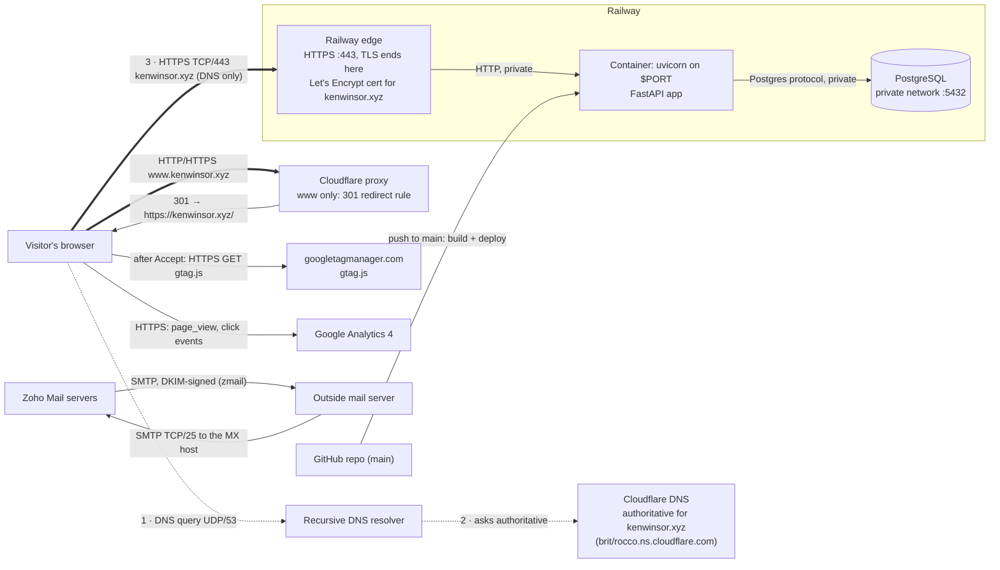
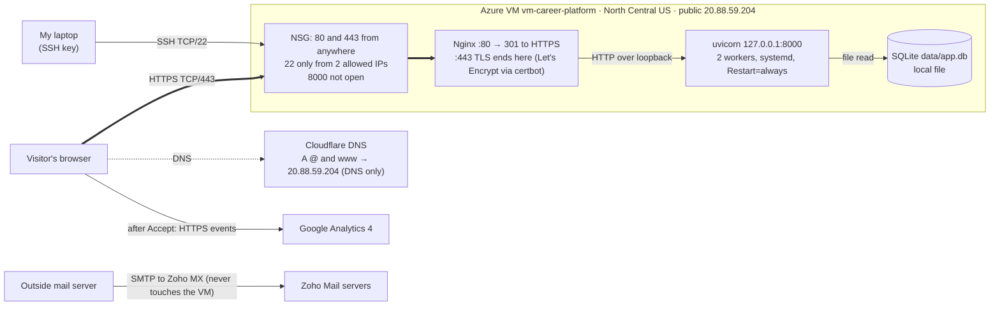

# career-platform

My personal resume site, live at **https://kenwinsor.xyz/**. It is also the start of the career platform I'm building through the semester.

> **How this README was written.** Drafted with Claude Code on 2026-10-26 from this repository, its Git history, plans, and saved evidence, plus checks run that day. It is a retrospective account: anything not backed by a linked file, commit, or dated check is marked **Unverified**. The plans under `docs/superpowers/` were written before the work they describe; this README was written afterward.

Submission index: [docs/project-1-submission.md](docs/project-1-submission.md)

## Contents

1. [What the site does](#what-the-site-does)
2. [Set up and run locally](#set-up-and-run-locally)
3. [Update the site](#update-the-site)
4. [Roll back a bad change](#roll-back-a-bad-change)
5. [Architecture](#architecture)
6. [DNS records](#dns-records)
7. [HTTPS certificates](#https-certificates)
8. [Migration to Railway and PostgreSQL](#migration-to-railway-and-postgresql)
9. [Who manages what: Azure vs Railway](#who-manages-what-azure-vs-railway)
10. [Email (Zoho)](#email-zoho)
11. [Analytics (GA4)](#analytics-ga4)
12. [Decisions](#decisions)
13. [Investigated failures](#investigated-failures)
14. [Costs, expiration dates, and cleanup](#costs-expiration-dates-and-cleanup)
15. [Limitations](#limitations)
16. [Reflection](#reflection)

## What the site does

A FastAPI application renders one resume page (`/` and `/resume`) and a privacy page (`/privacy`). On every request it reads my profile, experience, education, skills, contact links, and projects from a database. `/health` returns `{"status":"ok"}` for the platform's health check.

- **Content source:** `content/resume.json` in this repo. Each deploy validates it and loads it into the database (`scripts/dev.sh`: `alembic upgrade head` → `validate_content.py` → `ingest_content.py` → uvicorn).
- **Database:** SQLite on the Azure VM, PostgreSQL on Railway. Tables are defined in `app/models.py` and created by Alembic migrations in `alembic/versions/`.
- **Database failure:** the page stays up and keeps showing my profile from `data/fallback.json`, a snapshot of my real published profile written at the last deploy, labeled "Showing a saved copy". The Projects section shows **"Projects temporarily unavailable"** and the response is **HTTP 503**. Projects are never served from the snapshot. Each request opens a new database session, so the next request after the database recovers shows the projects again and returns 200, with no restart. Tests: `tests/integration/test_database_outage.py`, `tests/integration/test_projects_recovery.py`, `tests/routes/test_projects.py`.
- **Empty projects table:** the section says "No projects listed yet." and the page returns 200.
- **Privacy:** items marked `private` or `draft` are stored but never rendered or written to the snapshot (`tests/integration/test_public_privacy.py`).

**Why a relational database, and why SQLite first.** The spec ([docs/superpowers/specs/2026-09-15-personal-resume-career-platform-design.md](docs/superpowers/specs/2026-09-15-personal-resume-career-platform-design.md)) chose SQLAlchemy models with Alembic migrations so the same schema runs on SQLite and PostgreSQL. SQLite needs no server, so it suited local development and the single Azure VM, where the app reads a local file. The course required Railway PostgreSQL for the second migration. Keeping SQLAlchemy meant switching engines was a `DATABASE_URL` change plus one driver fix ([26f445e](https://github.com/kwinsor1lmu/career-platform/commit/26f445e)).

## Set up and run locally

Requires Python 3.12+ and [uv](https://docs.astral.sh/uv/).

```bash
git clone https://github.com/kwinsor1lmu/career-platform.git
cd career-platform
uv sync --frozen
cp .env.example .env            # ENVIRONMENT=development, DATABASE_URL=sqlite:///./data/app.db
uv run alembic upgrade head
uv run python scripts/validate_content.py content/resume.json
uv run python scripts/ingest_content.py content/resume.json
uv run uvicorn app.main:app --reload
uv run pytest -q                # full suite, about 2.5 minutes
```

More detail, including the release guardrails: [docs/operations/local-and-azure.md](docs/operations/local-and-azure.md).

## Update the site

1. Edit code or `content/resume.json` on a branch.
2. Check locally: `uv run python scripts/validate_content.py content/resume.json` and `uv run pytest -q`.
3. Review the diff (`git diff main...`), commit, and push to `main`.
4. Railway builds the `Dockerfile` from `main` ([GitHub autodeploys](https://docs.railway.com/deployments/github-autodeploys)). The new deployment only takes traffic once `/health` passes (`railway.toml`). If the build, migration, or ingest fails, the previous deployment keeps serving.
5. Check the live site: `curl -s https://kenwinsor.xyz/health` and the page itself.

Railway variables (set in the Railway dashboard, never in Git): `DATABASE_URL=${{Postgres.DATABASE_URL}}`, `ENVIRONMENT=production`, `GA_MEASUREMENT_ID=G-RDD033RLK7`. Railway stages variable changes until you click **Deploy**.

The reviewed change used as evidence for requirement 5 is recorded in [docs/evidence/railway-cutover.md](docs/evidence/railway-cutover.md#verified-website-update).

## Roll back a bad change

**Application code.** Either:
- In Railway → web service → **Deployments**, choose the last good deployment → **Redeploy**. This is the fastest option and restores that image as it was.
- Or in Git: `git revert <bad-sha>` and push to `main`. Railway redeploys the reverted code. Prefer this when the fix must also stay in history.

**Resume and project data.** The data in Postgres is rebuilt from `content/resume.json` on every deploy, and ingest removes rows that are missing from the file. So rolling back data means rolling back that file: `git revert` the content commit and push, or redeploy an older deployment. The site accepts no visitor writes, so no data is written after a cutover that a rollback could lose.

**Database schema.** Migrations so far only add tables (`0002_projects.py` adds `projects`). Older code ignores an extra table, so redeploying older code works without touching the schema. To remove a migration, run `alembic downgrade <revision>` against the database; that needs the Railway public database URL, which currently doesn't work from my laptop (see [Limitations](#limitations)). Before any destructive migration, take a backup first (Railway → Postgres → Backups, or `pg_dump`).

**Hosting (Railway → Azure VM).** In Cloudflare DNS, replace the `kenwinsor.xyz` CNAME with `A @ 20.88.59.204`, **DNS only**. The VM still runs the earlier version with its own Let's Encrypt certificate, so it answers immediately. The `www` redirect keeps working either way. The VM's SQLite data is older than Railway's, but since all data comes from `content/resume.json`, running `git pull`, `alembic upgrade head`, and the ingest on the VM brings it up to date.

## Architecture

### Railway (current, since 2026-10-26)



### Azure VM (first deployment, now kept as the rollback)



A step-by-step trace of one request, from Wi-Fi to the database, is in [docs/request-path-diagram.md](docs/request-path-diagram.md). Mail and analytics never touch the web server: mail goes from DNS straight to Zoho's servers, and analytics goes from the visitor's browser straight to Google.

## DNS records

Cloudflare is the authoritative DNS provider. Nameservers at the registry: `brit.ns.cloudflare.com` and `rocco.ns.cloudflare.com`. Checked on 2026-10-26 with `nslookup … brit.ns.cloudflare.com`, `dns.google/resolve`, and the `.xyz` RDAP.

| Name | Type | Value | Proxy | Purpose |
|---|---|---|---|---|
| `kenwinsor.xyz` | CNAME (flattened) | `0z13fs8z.up.railway.app` | DNS only | Site on Railway |
| `_railway-verify` | TXT | `railway-verify=b43f…3b88` | — | Proves to Railway that I control the domain |
| `www` | A | `192.0.2.1` (placeholder) | Proxied | Lets Cloudflare answer the `www` → apex redirect rule |
| `kenwinsor.xyz` | MX | `mx.zoho.com` (10), `mx2.zoho.com` (20), `mx3.zoho.com` (50) | — | Incoming mail goes to Zoho |
| `kenwinsor.xyz` | TXT | `v=spf1 include:zohomail.com ~all` | — | SPF: Zoho may send for the domain |
| `zmail._domainkey` | TXT | `v=DKIM1; k=rsa; p=MIGf…` | — | DKIM public key for Zoho's signatures |
| `_dmarc` | TXT | `v=DMARC1; p=none; rua=mailto:ken@kenwinsor.xyz` | — | DMARC policy (monitor only) and report address |
| `kenwinsor.xyz` | TXT | `zoho-verification=zb06635554.zmverify.zoho.com` | — | Proves domain ownership to Zoho |

**Redirect rule** (Cloudflare → Rules → Redirect Rules): when the hostname equals `www.kenwinsor.xyz`, send a 301 to `concat("https://kenwinsor.xyz", http.request.uri.path)`, keeping the query string. Railway's trial allows one custom domain, so `www` never reaches Railway.

Verification on 2026-10-26:

```text
$ curl -s -D - -o /dev/null http://www.kenwinsor.xyz/  | grep -i ^location
Location: https://kenwinsor.xyz/
$ curl -s -D - -o /dev/null https://www.kenwinsor.xyz/ | grep -i ^location
Location: https://kenwinsor.xyz/
$ curl -sI https://kenwinsor.xyz/ | grep -i ^server
server: railway-hikari
```

On the Azure VM, both `@` and `www` were `A 20.88.59.204`, DNS only.

## HTTPS certificates

- **Azure VM:** my own explanation (Exercise 04) is in [docs/how-this-site-is-secured.md](docs/how-this-site-is-secured.md). It covers the Let's Encrypt certificate for `kenwinsor.xyz` and `www.kenwinsor.xyz` (valid Oct 6, 2026 – Jan 4, 2027), certbot's renewal timer, and the open ports.
- **Railway:** Railway requests and renews a Let's Encrypt certificate for `kenwinsor.xyz` itself, once its TXT check passes and the CNAME points at it. On 2026-10-26, `openssl s_client` showed `subject=CN=kenwinsor.xyz`, issued by Let's Encrypt; the full output is in [docs/evidence/railway-cutover.md](docs/evidence/railway-cutover.md#https-at-the-new-destination). I don't manage renewal on Railway. I only have to keep the DNS records in place.
- **`www`:** Cloudflare presents its own edge certificate for `www.kenwinsor.xyz` and answers with the redirect. TLS for `www` ends at Cloudflare.

## Migration to Railway and PostgreSQL

- **Plan, written before the change:** [docs/superpowers/plans/2026-10-07-railway-migration.md](docs/superpowers/plans/2026-10-07-railway-migration.md). It inventories the code, runtime (Dockerfile, Python 3.12), packages (`uv.lock`), configuration and secrets (`DATABASE_URL` and `ENVIRONMENT` as Railway variables), schema (Alembic), and data (`content/resume.json`). Git moves code, schema migrations, and resume content. Secrets and Railway variables are set in the dashboard. The VM's SQLite file is not copied, because the data is rebuilt from the content file.
- **Compatibility changes for PostgreSQL:** the driver fix for plain `postgresql://` URLs ([26f445e](https://github.com/kwinsor1lmu/career-platform/commit/26f445e)), and trusting Railway's proxy headers so links and the stylesheet use `https://` ([cb3ae98](https://github.com/kwinsor1lmu/career-platform/commit/cb3ae98)).
- **Real change to the data:** the repository's `content/resume.json` was a placeholder ("Ada Example"); my real resume existed only in the VM's database. [f6b65fa](https://github.com/kwinsor1lmu/career-platform/commit/f6b65fa) replaced the placeholder with my real resume, reproduced from the VM's data, so restoring the seed data would fail the comparison. The projects table and its first entry were added after the cutover ([bdd262c](https://github.com/kwinsor1lmu/career-platform/commit/bdd262c)).
- **Comparison, cutover, and post-cutover checks:** [docs/evidence/railway-cutover.md](docs/evidence/railway-cutover.md).
- **Rollback:** [Roll back a bad change](#roll-back-a-bad-change).

## Who manages what: Azure vs Railway

| Layer | Azure VM (IaaS) | Railway (PaaS) |
|---|---|---|
| Hardware, network, hypervisor | Microsoft | Railway (and its cloud provider) |
| Operating system and patches | **Me** (Ubuntu 24.04, `apt upgrade`) | Railway (container host); I choose the base image in the `Dockerfile` |
| Runtime (Python) | **Me**, installed with uv on the VM | **Me**, pinned in the `Dockerfile`; Railway builds it |
| Web entry point | **Me**: Nginx config, NSG rules | Railway edge proxy |
| TLS certificate | **Me**: certbot and its renewal timer | Railway issues and renews; I keep the DNS records correct |
| Process management | **Me**: systemd unit, workers, restart | Railway restarts the container and checks `/health` |
| Application code | **Me** | **Me** |
| Configuration and secrets | **Me**: `.env` on the VM | **Me**, stored as Railway variables |
| Database software | **Me** (SQLite file) | Railway (managed Postgres service) |
| Data and backups | **Me** | **Me**: contents, migrations, and backups. Railway runs the server |
| DNS | **Me** (Cloudflare) | **Me** (Cloudflare) |
| Firewall and SSH | **Me**: NSG allowlist | No SSH; Railway exposes only the HTTP port |

What's still my job on Railway: the code and its dependencies (keep `uv.lock` patched), the `Dockerfile` base image, migrations and data, secrets, DNS, watching deploys and logs, staying inside the trial's credit, and planning the move to AWS before the trial ends.

## Email (Zoho)

`ken@kenwinsor.xyz` on Zoho Mail's free plan; Cloudflare stays the DNS provider. The records are in the [DNS table](#dns-records). Evidence: [docs/evidence/ex06.md](docs/evidence/ex06.md) and [docs/evidence/zoho-header-check.md](docs/evidence/zoho-header-check.md).

- **MX** tells other mail servers to deliver `@kenwinsor.xyz` mail to Zoho.
- **SPF** lists who may send as the domain (`include:zohomail.com`). Receivers check the sending server's IP against it.
- **DKIM:** Zoho signs each outgoing message, and receivers check the signature against the public key at `zmail._domainkey.kenwinsor.xyz`.
- **DMARC** (`p=none`) asks receivers to check that SPF or DKIM passes *and* matches the From domain, and to send reports to me, without rejecting anything yet.

**Status:** inbound delivery verified Oct 13. On 2026-10-26 an outside verifier reported **SPF pass, DKIM pass (`d=kenwinsor.xyz`), and DMARC pass** for a message from `ken@kenwinsor.xyz` ([zoho-header-check.md](docs/evidence/zoho-header-check.md)). The reply and outbound tests arrived in the school mailbox (checked 2026-10-26). A message sent before MX existed bounced back to the sender ([ex06.md](docs/evidence/ex06.md)).

## Analytics (GA4)

The GA4 tag (`G-RDD033RLK7`) loads only after the visitor clicks **Accept** on the consent banner (`app/static/consent.js`, `app/templates/base.html`). Then the browser downloads `gtag.js` from googletagmanager.com and sends events over HTTPS straight to Google Analytics: a `page_view` for each page and, with Enhanced Measurement, a `click` with `link_url`, `link_domain`, and `outbound=true` when a visitor follows a link to another site. The web server never sees or forwards any of this.

**Why the click matters:** the outbound links are my GitHub profile and this project's repository, so a click shows that a visitor went past the resume to look at my work.

Evidence: [docs/evidence/ex06.md](docs/evidence/ex06.md#3-google-analytics). On 2026-10-26, a Realtime screenshot on the live Railway site shows `page_view`, `session_start`, and `click` (1 each) after I accepted the banner and followed an outside link. The `click` event carried `link_url`, `link_domain`, and `outbound`, which Enhanced Measurement only adds to outbound link clicks.

## Decisions

1. **Railway with managed PostgreSQL instead of staying on the Azure VM.** Alternatives: stay on the VM with SQLite, or run PostgreSQL on the VM. The course required the Railway migration. Beyond that, Railway takes the OS, Nginx, certbot, and systemd off my list, and deploys from a Git push. The cost is less control (no SSH, one custom domain on the trial) and a 30-day trial. Plan: [2026-10-07-railway-migration.md](docs/superpowers/plans/2026-10-07-railway-migration.md).
2. **Managed email (Zoho) instead of a self-hosted mail server.** Alternatives: Postfix and Dovecot on the VM, or forwarding only (for example Cloudflare Email Routing). Running my own mail means open ports 25/587/993, spam filtering, and keeping a sending IP with a good reputation, which cloud VM addresses rarely have. Forwarding can't send as `ken@kenwinsor.xyz`. Zoho's free plan sends and receives from my address and gives me the DKIM key, while Cloudflare stays my DNS. Written in class (Exercise 06).
3. **Rebuild the database from `content/resume.json` on every deploy, instead of copying the database between hosts.** Alternative: dump SQLite and load it into Postgres. Rebuilding makes Git the source of truth and every deploy repeatable; a migration becomes "deploy, then compare". The cost is that edits made directly in the database are overwritten on the next deploy, so the site can't accept visitor writes without changing this design.
4. **`www` through a Cloudflare redirect rule instead of a second Railway domain.** The trial allows one custom domain. A proxied `www` record with a 301 rule keeps one address after the VM is gone.

## Investigated failures

1. **Application / dependency failure: tests and ingest failed on Windows.** Symptom: 8 tests failed, and loading the resume into the database failed. Check: every traceback ended at the same line, `app/content/fallback.py:48`, which fsyncs a directory, something Windows doesn't allow. Fix: only run that step on POSIX systems. Repeated check: the suite went from 23 passed / 8 failed to 31 passed. Details: [docs/evidence/ex03.md](docs/evidence/ex03.md#3-what-went-wrong-how-i-investigated-and-what-confirmed-the-fix).
2. **DNS failure: the registrar suspended the domain (real, about Oct 16–26).** Symptom: the site and mail stopped resolving. Checks: `nslookup -type=NS` returned `verify-contact-details.namecheap.com` and `failed-whois-verification.namecheap.com`; the A record pointed at a Namecheap parking IP (`198.54.117.242`); the VM still answered on its own IP. Diagnosis: Namecheap suspends domains whose registrant email isn't verified within 15 days of registration. Repair: verified the contact email. Repeated check (2026-10-26): the `.xyz` RDAP listed `brit`/`rocco.ns.cloudflare.com` again, and Google and Cloudflare resolvers returned the correct records. Record: [docs/evidence/ex06.md](docs/evidence/ex06.md#failed-check-domain-dns-suspended) and [docs/evidence/railway-cutover.md](docs/evidence/railway-cutover.md#before-the-cutover-domain-restored).
3. **TLS failure during the cutover: Railway wouldn't issue a certificate (2026-10-26).** Symptom: after the DNS change, `kenwinsor.xyz` kept presenting Railway's generic `*.up.railway.app` certificate for over an hour, and Railway later answered "Application not found". Checks: the CNAME and the `_railway-verify` TXT resolved correctly from Google, Cloudflare, and Quad9 DNS; there were no CAA or AAAA records; Railway's dashboard showed a yellow warning on the TXT record. Repair: deleted and re-added the custom domain in Railway. Repeated check: the warning cleared, and within seconds the certificate showed `CN=kenwinsor.xyz`. Record: [docs/evidence/railway-cutover.md](docs/evidence/railway-cutover.md#cutover).
4. **Deliberate lab failure (simulation): a stale DNS record with a mismatched certificate.** Exercise 05 used the supplied simulation, not my domain: [docs/evidence/ex05.md](docs/evidence/ex05.md).

## Costs, expiration dates, and cleanup

| Service | What it's for | Cost | Expires / renews | Cleanup plan |
|---|---|---|---|---|
| Azure for Students | VM `Standard_B2ats_v2`, disk, public IP, NSG (`rg-career-platform`) | Paid from student credit. Actual cost Sep 1 – Oct 26, 2026 (Cost Management API, queried 2026-10-26): **$10.52**, made up of public IP (billed as Virtual Network) $7.67, disk storage $2.85, VM compute $0.00, bandwidth <$0.01. The public IP and disk keep charging while the VM exists. **Unverified:** credit remaining | **Unverified:** credit end date | Keep running until the instructor says otherwise, then delete the resource group |
| Railway trial | Web service + Postgres | Trial credit: $5 or 30 days, whichever comes first. As of 2026-10-26: **$4.22 left** ($0.78 used) | **12 days left as of 2026-10-26, so the trial ends about 2026-11-07** | Migrate to AWS before it ends, then delete the project |
| Namecheap | `kenwinsor.xyz` registration | $2 (first year) | Registered 2026-10-01, expires 2027-10-01 | Turn off auto-renew if I stop using the domain |
| Cloudflare | DNS, `www` redirect | Free plan | — | — |
| Zoho Mail | `ken@kenwinsor.xyz` | Forever Free plan | — | — |
| Google Analytics 4 | Visit measurement | Free | Event data kept up to 14 months | — |

## Limitations

- **GA4 parameter values aren't shown.** The screenshots show that the `click` event had `link_url` and `outbound` parameters, but not their values.
- **No row-level database comparison.** The public Postgres credentials in my local `.env` no longer work, so I can't query Railway Postgres from my laptop. Source and target were compared through the rendered page instead.
- **The PostgreSQL migration for `projects` was only checked by the Railway deploy itself.** There's no local PostgreSQL; locally it was tested on SQLite (upgrade, ingest, downgrade, upgrade).
- **The page needs the database to list projects**, by design. During an outage only the profile snapshot shows, with a 503.
- **Database edits are overwritten on deploy**, because the content file is the source of truth.
- **Single region, single instance**, and the site stops if the Railway trial runs out.
- **The Railway database password was pasted into a chat session** on 2026-10-26. Rotating it is planned.

## Reflection

**Written afterward (2026-10-26). Kenneth: rewrite this in your own words before submitting.** _Draft points to react to:_ how much of "the site is down" happened outside my code. The registrar, DNS caching, and a platform's domain verification each caused a real outage this month, and none of them showed up in my test suite. Moving to Railway took Nginx, certbot, and systemd off my list, but not DNS, secrets, data, or watching deploys. Next time I'd verify the registrant email on day one, record evidence as I go instead of afterward, and confirm the target's TLS works before moving DNS, not after.
