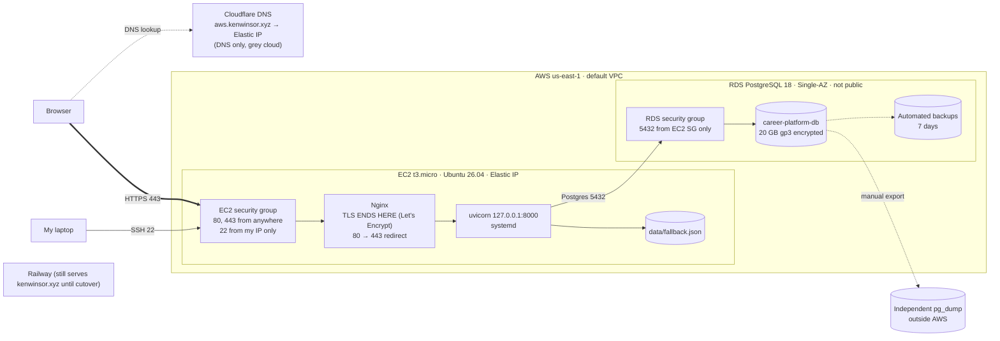

# AWS migration: architecture decision

Decided 2026-11-03 (session 18).

I chose **EC2 + Single-AZ RDS PostgreSQL** over **EC2 + local PostgreSQL** because **I want the least operating work I can get without changing application code**, and I accept **about $13/month more (~$26 vs ~$13, covered by the $100 credit) and a database that goes down if its one availability zone has an outage**.

Lambda + API Gateway + RDS was rejected: it would need a Mangum adapter, moving `alembic upgrade` and content ingest out of startup, and replacing the on-disk fallback file, and it isn't covered by the course deployment policy.

## Checks

| Requirement | How this option meets it |
| --- | --- |
| App runs with changes I understand | No code changes; only `DATABASE_URL` points at RDS |
| Data moves intact | `pg_dump` from Railway, `pg_restore` from the EC2 instance into RDS |
| PostgreSQL stays private | RDS not publicly accessible; port 5432 only from the EC2 security group |
| Every service on my plan | EC2 t3.micro, RDS db.t3/t4g.micro Single-AZ 20 GB, gp3, public IPv4: all Free-plan eligible and paid from credits |

Watch-out: `scripts/dev.sh` runs `ingest_content.py` on every start, which syncs the database to `content/resume.json` and deletes rows not in it.

## Planned request path

