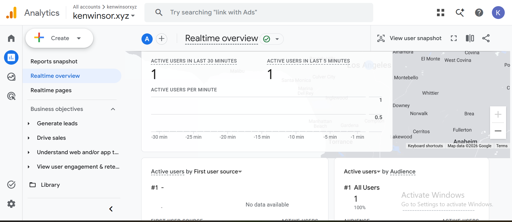

# Exercise 06: Domain email and Google Analytics

Domain address: `ken@kenwinsor.xyz` (Zoho Mail, free plan). Outside mailbox: my school account. Tests 02–04 were run through the Zoho MCP server from Claude Code; Test 01 was sent from the outside mailbox.

## 1. Email tests

| Test | Time (PDT) | Result | Arrived in outside mailbox? |
|---|---|---|---|
| Received: "Test 01: inbound", outside mailbox → `ken@kenwinsor.xyz` | Oct 13, 2:53 PM | Delivered to the Zoho Inbox | n/a |
| Replied: "Re: Test 01: inbound", `ken@kenwinsor.xyz` → outside mailbox | Oct 20, 11:44 AM | Zoho accepted and sent it | Not yet confirmed at submission time |
| Sent new: "Test 02: outbound", `ken@kenwinsor.xyz` → outside mailbox | Oct 13, 2:56 PM | Zoho accepted and sent it | Not yet confirmed at submission time |

The reply was sent while the domain's DNS was down (see "Failed check" below), so the domain's SPF and DKIM records weren't published at that moment. Test 02 was sent while DNS was working.

## 2. SPF, DKIM, and DMARC

Received in the outside mailbox, from the message headers of "Test 02: outbound":

Not completed by the deadline. I haven't yet pulled Test 02's headers from the outside mailbox. Next step: open Test 02 in the outside mailbox, view the message source, and add the `spf=`, `dkim=`, and `dmarc=` results here.

## 3. Google Analytics

- Live site: https://kenwinsor.xyz/
- Privacy page: https://kenwinsor.xyz/privacy

The tag loads only after a visitor clicks Accept on the consent banner. For the test, I accepted and viewed the home page.

The Realtime overview shows my test visit arriving in GA4, so the tag is collecting on the live deployment. I didn't capture the `page_view` and `click` event cards or the click's `link_url`, `link_domain`, and `outbound` details before the deadline. Next step: open the `click` event in Realtime's "Event count by Event name" card and screenshot its parameters.

## Failed check: domain DNS suspended

- **What happened:** By Oct 19, the site and domain mail stopped working. Namecheap had switched the domain's nameservers from Cloudflare to `verify-contact-details.namecheap.com` and `failed-whois-verification.namecheap.com` because the registrant contact details weren't verified within the deadline. The domain then pointed at Namecheap's verification page, and the Cloudflare A, MX, SPF, DKIM, and DMARC records stopped being served. The VM itself kept serving the site.
- **What I tried:** On Oct 20 I went through Namecheap's contact verification; the domain page no longer shows a warning. As of 11:40 AM PDT the registry still listed the verification nameservers. For the Analytics test, I reached the deployed VM directly by mapping `kenwinsor.xyz` to its IP in a separate Chrome profile. The page, its certificate, and the GA events were the real ones. My Namecheap settings still list the Cloudflare nameservers (`brit` and `rocco.ns.cloudflare.com`), and the Cloudflare zone still answers correctly (A → the VM, MX → Zoho). The verification hold overrides those nameservers at the registry.
- **Next step:** Complete or resend Namecheap's verification, or ask Namecheap support to lift the hold. Once the registry lists the Cloudflare nameservers again, re-check the site, MX, and mail authentication.
