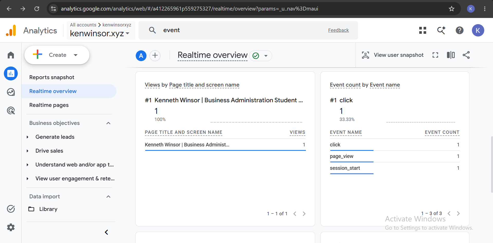
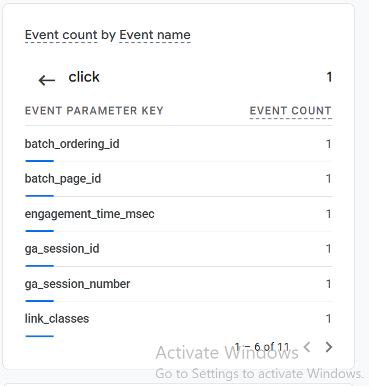
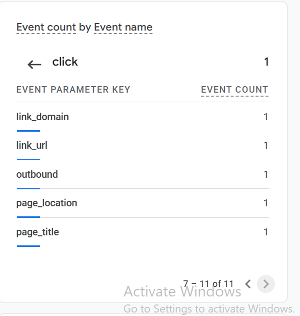

# Exercise 06: Domain email and Google Analytics

Domain address: `ken@kenwinsor.xyz` (Zoho Mail, free plan). Outside mailbox: my school account. Tests 02–04 were run through the Zoho MCP server from Claude Code; Test 01 was sent from the outside mailbox.

## 1. Email tests

| Test | Time (PDT) | Result | Arrived in outside mailbox? |
|---|---|---|---|
| Received: "Test 01: inbound", outside mailbox → `ken@kenwinsor.xyz` | Oct 13, 2:53 PM | Delivered to the Zoho Inbox | n/a |
| Replied: "Re: Test 01: inbound", `ken@kenwinsor.xyz` → outside mailbox | Oct 20, 11:44 AM | Zoho accepted and sent it | Yes, confirmed in the school inbox (checked 2026-10-26) |
| Sent new: "Test 02: outbound", `ken@kenwinsor.xyz` → outside mailbox | Oct 13, 2:56 PM | Zoho accepted and sent it | Yes, confirmed in the school inbox (checked 2026-10-26) |

The reply was sent while the domain's DNS was down (see "Failed check" below), so the domain's SPF and DKIM records weren't published at that moment. Test 02 was sent while DNS was working.

**Before MX (added 2026-10-26):** a message from my school mailbox to `ken@kenwinsor.xyz`, sent before any MX record existed, **bounced back to my school inbox**. With no MX record, the sending server had nowhere to deliver mail for `kenwinsor.xyz`, so it returned the message as undeliverable. Zoho has no trace of it, as expected: the earliest messages in the Zoho mailbox are its welcome emails from 2:27 PM on Oct 13, when the mailbox was created.

### Mailbox record (Zoho Sent and Inbox, read through the Zoho API on 2026-10-26)

Times are Zoho's server timestamps, converted to PDT.

| When (PDT) | Folder | Message | Between |
|---|---|---|---|
| Oct 13, 2:27 PM | Inbox | Zoho welcome emails | Zoho → `ken@kenwinsor.xyz` (mailbox created) |
| Oct 13, 2:53 PM | Inbox | Test 01: inbound | school mailbox → `ken@kenwinsor.xyz` |
| Oct 13, 2:56 PM | Sent | Test 02: outbound | `ken@kenwinsor.xyz` → school mailbox |
| Oct 13, 3:15 PM | Sent | Test 03: Deliverability | `ken@kenwinsor.xyz` → mail-tester.com test address |
| Oct 15, 2:33 PM | Sent | Test 04: outbound | `ken@kenwinsor.xyz` → school mailbox |
| Oct 20, 11:44 AM | Sent | Re: Test 01: inbound | `ken@kenwinsor.xyz` → school mailbox |
| Oct 26, 10:41 PM | Sent / Inbox | Authentication check, and Port25's report | `ken@kenwinsor.xyz` ↔ `verifier.port25.com` |

No bounce or delivery-failure notice exists in any folder, including Spam and Trash. On 2026-10-26 I checked the school mailbox: the Zoho messages (Tests 02 and 04, and the reply) had arrived.

## 2. SPF, DKIM, and DMARC

Done on 2026-10-26 with an outside verifier, after DNS was restored: **SPF pass, DKIM pass (`d=kenwinsor.xyz`, `s=zmail`), DMARC pass.** The full header excerpt and explanation are in [zoho-header-check.md](zoho-header-check.md).

Earlier note, kept for the record: Test 02's headers weren't pulled from the outside mailbox before the Exercise 06 deadline.

## 3. Google Analytics

- Live site: https://kenwinsor.xyz/
- Privacy page: https://kenwinsor.xyz/privacy

The tag loads only after a visitor clicks Accept on the consent banner. For the test, I accepted and viewed the home page.

The Realtime overview shows my test visit arriving in GA4, so the tag is collecting on the live deployment. I didn't capture the `page_view` and `click` event cards or the click's `link_url`, `link_domain`, and `outbound` details before the deadline. Next step: open the `click` event in Realtime's "Event count by Event name" card and screenshot its parameters.

### Re-test on the real domain after the Railway cutover (added 2026-10-26)

Action: on https://kenwinsor.xyz (served by Railway, normal DNS, no hosts-file override), I clicked **Accept** on the banner, viewed the home page, and clicked an outside link on the page (the GitHub link). Screenshot taken 2026-10-26, 10:10 PM PDT.

Observed in Realtime:

| Event | Count | What triggered it |
|---|---|---|
| `page_view` | 1 | Loading the home page after accepting |
| `session_start` | 1 | The first event of a new visit |
| `click` | 1 | Following the outside link. Enhanced Measurement records it as an outbound click |

**Why the click is useful:** the outside links on my page go to my GitHub and this project's repository. A `click` shows that a visitor went past the resume to look at my work, which tells me more than a page view does.

**How it gets there:** after Accept, the browser loads `gtag.js` from googletagmanager.com and sends each event over HTTPS straight to Google Analytics. My server never sees or forwards it.

**The click's parameters.** Opening `click` in the "Event count by Event name" card lists the 11 parameters sent with it. Among them are `link_url`, `link_domain`, and `outbound`. GA4's Enhanced Measurement attaches those only to clicks on links that leave the site, so this click was an outbound link click.

**Not shown:** the parameters' values, such as the exact `link_url`. The screenshots list the parameter names with a count of 1 each.

## Failed check: domain DNS suspended

- **What happened:** By Oct 19, the site and domain mail stopped working. Namecheap had switched the domain's nameservers from Cloudflare to `verify-contact-details.namecheap.com` and `failed-whois-verification.namecheap.com` because the registrant contact details weren't verified within the deadline. The domain then pointed at Namecheap's verification page, and the Cloudflare A, MX, SPF, DKIM, and DMARC records stopped being served. The VM itself kept serving the site.
- **What I tried:** On Oct 20 I went through Namecheap's contact verification; the domain page no longer shows a warning. As of 11:40 AM PDT the registry still listed the verification nameservers. For the Analytics test, I reached the deployed VM directly by mapping `kenwinsor.xyz` to its IP in a separate Chrome profile. The page, its certificate, and the GA events were the real ones. My Namecheap settings still list the Cloudflare nameservers (`brit` and `rocco.ns.cloudflare.com`), and the Cloudflare zone still answers correctly (A → the VM, MX → Zoho). The verification hold overrides those nameservers at the registry.
- **Next step:** Complete or resend Namecheap's verification, or ask Namecheap support to lift the hold. Once the registry lists the Cloudflare nameservers again, re-check the site, MX, and mail authentication.
