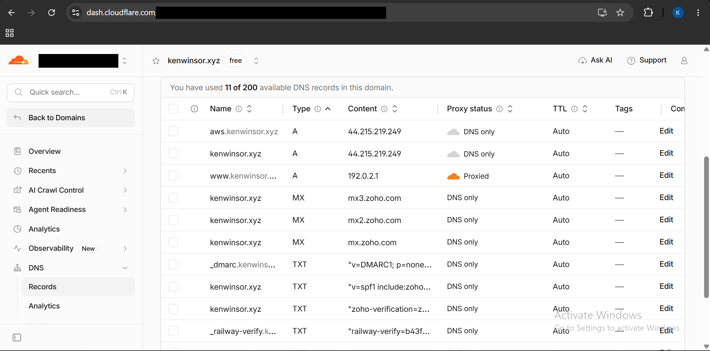
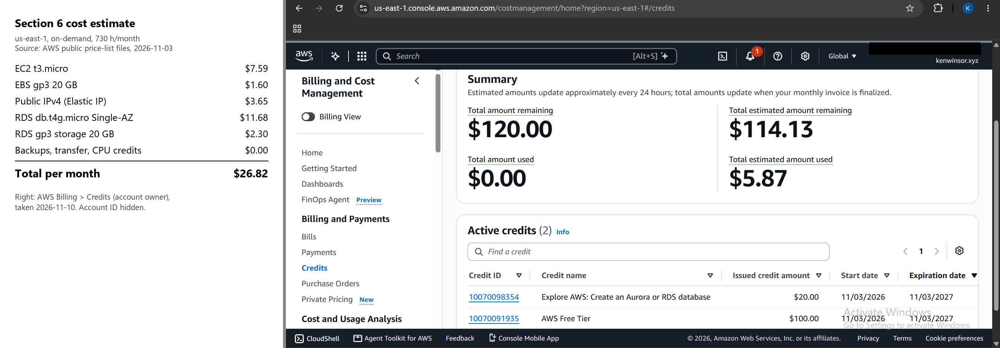

# Exercise 07: Move to AWS

Architecture diagram: [README → Architecture → AWS (EC2 + RDS)](../../README.md#aws-ec2--rds). Full log: [docs/aws-migration-notes.md](../aws-migration-notes.md).

## 1. Architecture decision

I chose **EC2 + Single-AZ RDS PostgreSQL** over **EC2 with PostgreSQL on the same server** because **I want the least operating work I can get without changing application code**, and I accept **about $13/month more (~$26 vs ~$13, covered by the Free plan credits) and a database that goes down if its one availability zone has an outage**.

## 2. Backup record

| Item | Value |
| --- | --- |
| Date | 2026-11-03 21:51 UTC. `pg_dump` 18.6 custom format of Railway's Postgres, run inside the container over `railway ssh` because the database had no public address. 37,922 bytes, SHA-256 recorded in the notes. Stored outside the repo. |
| Restore test | Restored into a scratch local PostgreSQL 18.6 database in **0.37 s** with no errors. Row counts and a per-table MD5 over every row matched Railway for **all 8 tables**, and the app served the real resume from the restored copy. |
| Restore into AWS | The same file restored into RDS in **0.26 s**. Hashes matched Railway for all 8 tables, and still matched after the app's first start. |
| Accepted RPO | Effectively **zero** for committed content: the database is rebuilt from `content/resume.json` in Git on every start. |
| Accepted RTO | **30 minutes** to a working copy (restore takes under a second; the rest is provisioning and DNS). |
| Ongoing | RDS automated backups with 1-day retention (Free plan limit), plus a `pg_dump` before any data change. |

## 3. Verification on aws.kenwinsor.xyz

Tested 2026-11-10. Railway was already down (trial ended), so the baseline is the backup and the repo.

| Test | Evidence | Result |
| --- | --- | --- |
| Pages | `/` 200 (title "Kenneth Winsor \| …"), `/privacy` 200, `/health` 200 | Pass |
| Static files | `/static/styles.css` 200 text/css; font `ibm-plex-sans-400.woff2` 200, 22,588 B, same as the repo | Pass |
| Unknown path | `/nope-404` → 404 | Pass |
| HTTPS | Let's Encrypt certificate for `aws.kenwinsor.xyz`, valid to 2027-02-08; `http://` → 301 to HTTPS | Pass |
| Certificate renewal | `certbot renew --dry-run` succeeded; `certbot.timer` active | Pass |
| Data matches backup | Per-table hashes on RDS match Railway for all 8 tables | Pass |
| Change survives restarts | Test skill "AWS migration test (remove before cutover)" added via `resume.json`: shown on the page, RDS `skills` = 9, still there after a second restart | Pass |
| Survives reboot | `sudo reboot`: site back in ~15 s with no manual step, swap on, test skill still there, `skills` = 9 | Pass |
| Database is private | `Test-NetConnection <rds-endpoint> -Port 5432` from my laptop → False (resolves to a private 172.31.x address); `PubliclyAccessible` false; DB security group allows 5432 only from the web security group | Pass |
| App port closed | Elastic IP port 8000 → False; port 5432 → False | Pass |
| SSH limited | Port 22 → True from my IP; security group allows 22 from two /32s only | Pass |
| IMDSv2 | `HttpTokens` required; request without a token → 401 | Pass |
| Sizes inside course policy | EC2 t3.micro; RDS db.t4g.micro, Single-AZ, 20 GB, encrypted, deletion protection on | Pass |
| Analytics | `GA_MEASUREMENT_ID` left empty on the test copy on purpose | Not verified |
| Independent backup copy | Dumps are only on my laptop so far | Not verified |

## 4. Cutover status

**Not cut over yet.** `kenwinsor.xyz` still has a CNAME to Railway, whose trial has ended, so the domain is down. `aws.kenwinsor.xyz` is the only record pointing at AWS.

What's left:

1. Remove the test skill.
2. Change the apex record to `A 44.215.219.249`, DNS only.
3. Get the certificate for `kenwinsor.xyz`.
4. Set the GA measurement ID.
5. Take a fresh RDS dump.
6. Merge `aws-migration` into `main`.

**When:** TODO

## 5. Cost

Estimate from section 6, using AWS public price-list files for us-east-1, on-demand, 730 h/month:

| Item | Month |
| --- | --- |
| EC2 t3.micro | $7.59 |
| EBS gp3 20 GB | $1.60 |
| Public IPv4 (Elastic IP) | $3.65 |
| RDS db.t4g.micro Single-AZ | $11.68 |
| RDS gp3 20 GB | $2.30 |
| Backups, data transfer, CPU credits | $0.00 |
| **Total** | **$26.82** |

Paid from the Free plan's credits. Estimate and the account owner's billing page:

