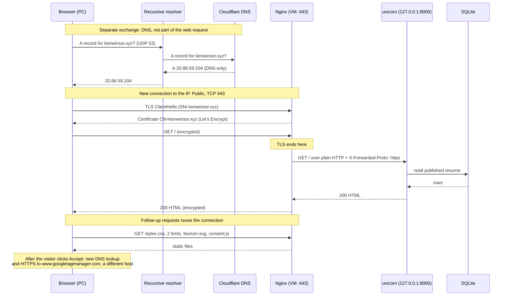

# Request path: entering kenwinsor.xyz in a browser

> Agent-assisted draft (Claude Code, 2026-10-20), checked against this repository. Practise redrawing it from memory: the midterm interview allows no notes.

## Network and both hosts

```mermaid
flowchart LR
  subgraph Home["Your network (at home, one box often combines AP + switch + router + NAT + DHCP + firewall)"]
    PC["Your PC<br/>Wi-Fi network interface<br/>private IP 192.168.x.x from DHCP<br/>default gateway = router"]
    AP["Wi-Fi access point"]
    SW["Switch<br/>(moves frames inside the LAN)"]
    RT["Router / default gateway<br/>NAT: private IP ↔ one public IP<br/>firewall: drops unrequested inbound traffic<br/>DHCP server"]
    MOD["Modem / fiber box"]
  end

  ISP["ISP network<br/>(internals unknown)"]

  RES["Recursive DNS resolver<br/>(ISP's or campus; check ipconfig /all)"]
  CF["Cloudflare<br/>authoritative DNS for kenwinsor.xyz"]

  subgraph Azure["Azure VM · public IP 20.88.59.204"]
    NSG["NSG firewall<br/>80, 443 open to all<br/>22 only from my 2 IPs<br/>8000 not open"]
    NG["Nginx :80 → redirect · :443<br/>TLS ENDS HERE<br/>Let's Encrypt cert (apex + www)"]
    UV["uvicorn 127.0.0.1:8000<br/>2 workers, run by systemd"]
    DB1[("SQLite<br/>data/app.db")]
  end

  subgraph Railway["Railway (internals unknown)"]
    EDGE["Railway edge proxy<br/>TLS ENDS HERE<br/>Railway-issued cert"]
    APP["Container: uvicorn on $PORT<br/>(no Nginx)"]
    DB2[("Postgres<br/>private network")]
  end

  PC -- "Wi-Fi" --- AP --- SW --- RT --- MOD --- ISP

  PC -. "1 · DNS query, UDP 53<br/>client: PC · server: resolver" .-> RES
  RES -. "2 · asks authoritative server<br/>client: resolver · server: Cloudflare" .-> CF

  ISP == "3a · HTTPS, TCP 443, public<br/>client: browser · server: Nginx" ==> NSG
  NSG ==> NG
  NG -- "plain HTTP, private (loopback)<br/>client: Nginx · server: uvicorn" --> UV
  UV -- "file read<br/>(no network)" --> DB1

  ISP == "3b · HTTPS, TCP 443, public<br/>client: browser · server: Railway edge" ==> EDGE
  EDGE -- "HTTP, private (details unknown)" --> APP
  APP -- "Postgres protocol, private<br/>client: uvicorn · server: Postgres" --> DB2
```

## One request in order (Azure path)

## How much to trust each part

- **From this repository:** the VM's IP, the NSG rules, Nginx with its Let's Encrypt certificate, uvicorn with 2 workers on `127.0.0.1:8000`, SQLite on Azure, uvicorn without Nginx on Railway, Postgres over Railway's private network, and the follow-up files the page loads. Sources: `docs/superpowers/plans/2026-10-01-operate-the-vm.md`, `docs/how-this-site-is-secured.md`, `docs/evidence/ex03.md`, `app/templates/base.html`, `app/static/consent.js`, and the `railway-migration` branch.
- **Assumptions:** the home equipment and `192.168.x.x` address are typical examples; check the real ones with `ipconfig /all`. Railway's internals and the Postgres port aren't in the repo, so they're left unlabeled or marked unknown.
- **Planned, not live:** the Railway path. After cutover, the DNS answer would be a CNAME to Railway instead of `A 20.88.59.204`, and the brief wants `www` redirected to the bare domain through a proxied Cloudflare record. Neither is recorded as done.
